<p align="center">
  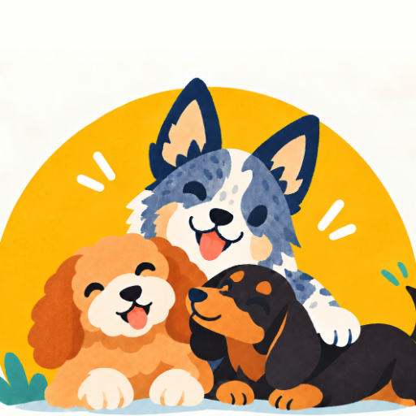
</p>

<h1 align="center">ThreeDog.js</h1>

<p align="center">
  A 3D game engine for the web, built on three.js and made to be used by AI coding agents.
</p>

<p align="center">
  <a href="LICENSE"></a>
</p>

<p align="center">
  English · <a href="README.zh-CN.md">中文</a>
</p>

<p align="center">
  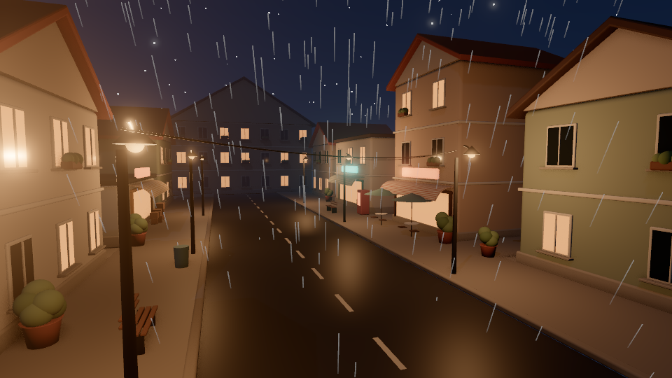
</p>

## Why it exists

An AI coding agent asked for a three.js game starts from an empty scene. Before it reaches the gameplay it has to write saving and loading, a day and night cycle, lights that follow the time of day, collision and weather, and it writes them again in the next game, a little differently each time. In a small game that only costs time. In a bigger one the pieces start to fight: the weather darkens the sky, the day cycle brightens it back, and a save made at dusk loads at noon.

ThreeDog takes over those systems so they are written once and work together. The agent spends its effort on what makes the game its own, which is the rules and the look.

## Design ideas

<p align="center">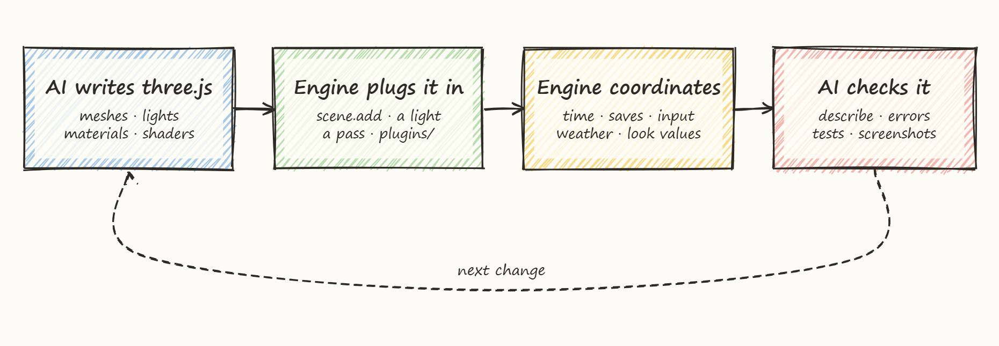</p>

**A board with slots, not a framework to learn.** Engine objects are ordinary three.js objects, so everything an agent already knows about three.js still applies. The engine offers slots: a sky, a material for a role, a post effect, a module for inventory or weather. Whatever the agent writes in plain three.js is plugged into the matching slot automatically where the engine can see the intent (adding to the scene, creating a light, adding a pass, dropping a file into `plugins/`), or with one line where it cannot.

**The engine never fights the game.** When a game writes a value itself, for example a light's intensity or the scene's fog, the engine stops writing it and records that the game owns it. Every change the engine makes to three.js itself is listed and can be inspected.

**The engine does three things and no more.** It coordinates systems that would otherwise disagree (time, weather, lights, saves). It takes on engineering that is hard and gets repeated in every game (streaming a large world, physics, pathfinding, saving without losing data). And it lets the agent see and check what it made. Anything three.js already does well, the engine leaves to three.js.

**One way to do each job.** Each task has one entry. When a better entry replaces an old one, the old one is removed and using it raises an error that shows the new call.

**The engine never decides how a game looks.** Without a game's own style, everything is drawn as neutral gray placeholders. Colors, materials, sky and post effects belong to the game, so very different styles sit on the same engine without either one looking like a default.

## Made for AI agents

Each feature below starts from a problem agents actually run into.

| Problem | What the engine does |
|---|---|
| Reading all the docs fills the agent's context before work begins | A one-page index ([AI.md](packages/engine/docs/AI.md)) has one line per task, and `threedog how "rain at night"` returns the one paragraph to read |
| An agent guesses an API from memory and gets it slightly wrong | Errors name the correct form. A removed option such as `sky({ dayLength })` throws an error that points to the module that now owns it |
| Two ways to do one thing, and the agent mixes them | Each task has one recommended entry, listed in a table in [CONVENTIONS.md](packages/engine/docs/CONVENTIONS.md) |
| The agent cannot tell what the running game is doing | `threedog describe` prints the game's state as short text, and `threedog explain` says why an action cannot run (for example, the door is locked and needs a key) |
| Checking a change means asking a person to play | The agent drives the game itself: it presses keys, steps time, runs actions and takes screenshots, from the command line or over MCP (Model Context Protocol, which tools such as Claude Code and Cursor use) |
| An agent cannot judge its own screenshot reliably | Every screenshot comes with a look check that reports facts: which areas are blown out or too dark, which light is likely the cause and its current value. It never suggests target values, because the look belongs to the game |

## Architecture

<p align="center">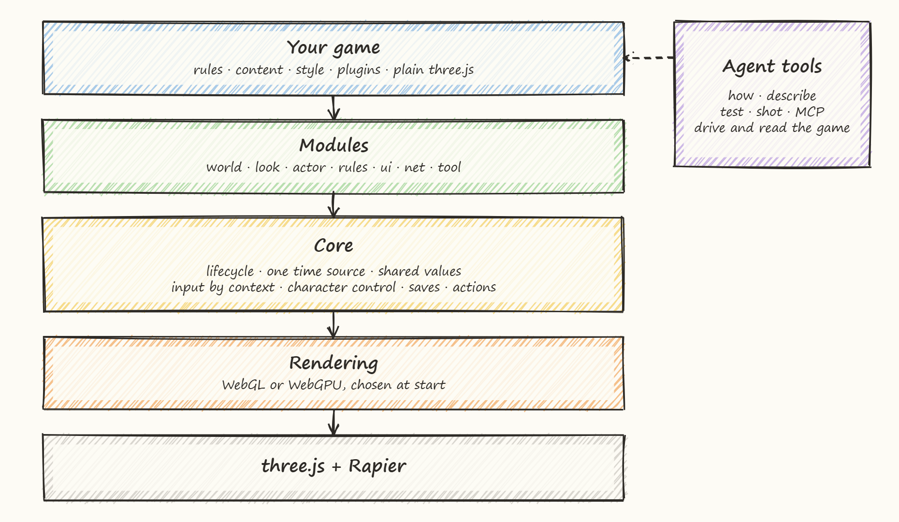</p>

- **Your game** holds its rules, content, style and plugins, and any plain three.js it writes.
- **Core** owns what every game shares and what must never disagree: the lifecycle (nothing runs before it is ready), one time source (slow motion and pause are views of it), values with owners, input grouped by context (menus and dialogue push a context instead of locking keys), one controller per character, saves that roll back cleanly when a load fails, and player actions that can be checked, logged and replayed.
- **Modules** add features on top of the core. A game installs only the ones it uses.
- **Rendering** runs the same engine content on WebGL and on WebGPU. Every visual effect the engine ships exists in both forms, and a check refuses an effect written for only one.
- **Agent tools** (`threedog how`, `describe`, `test`, `shot` and an MCP server) let an AI drive the running game and read its state.

### What is a module

A module is one feature with one declared type. It talks to the rest of the engine only through the core and through public contracts, so it can be removed or replaced without touching anything else.

<p align="center">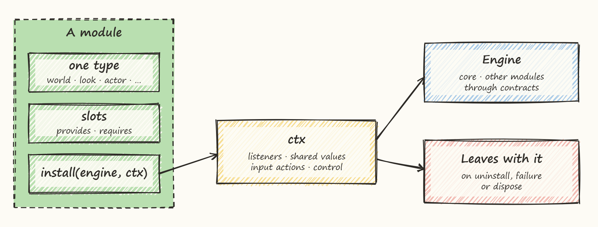</p>

| Type | What it owns |
|---|---|
| `world` | State of the world: terrain data, calendar, weather data. Draws nothing |
| `look` | How things appear: sky, terrain look, water, effects. Its errors never stop the game |
| `actor` | Characters and what moves them |
| `rules` | Gameplay: inventory, quests, interactions, through checked player actions |
| `ui` | Menus, HUD, settings. Its errors never stop the game |
| `net` | Multiplayer |
| `tool` | Development helpers |

A module of your own is written the same way and is treated the same as a built-in one. `engine.use(mine(), { replaces: 'inventory' })` swaps a built-in module for yours, and a contract check confirms the replacement offers everything the rest of the engine calls.

### How several owners share one value

The sun's brightness, the fog distance or the speed of time can be wanted by several parts of a game at once. Instead of each one writing the value and undoing the others, every writer adds an entry on a layer, and the engine recomputes the result from the entries that remain.

<p align="center">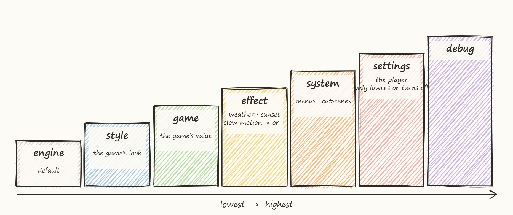</p>

From lowest to highest: the engine's default, the game's style, the game's own value, temporary effects such as weather, sunset or slow motion (they multiply or add), menus and cutscenes, the player's settings (which may only lower a value or switch it off), and debug.

- An effect that ends simply removes its entry, so effects can end in any order and nothing remembers a stale value.
- The player's settings sit above menus and cutscenes, so nothing the game does can switch back on what the player turned off.
- Two owners setting the same value on the same layer is an error in development, and `describe()` shows who wrote every value.

### How the look is put together

<p align="center">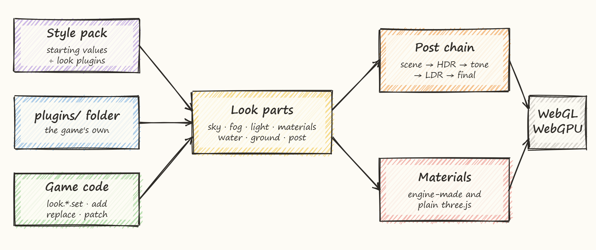</p>

A style pack is a folder of starting values plus look plugins. A plugin works alone or inside several style packs, through the same path as the game's own `plugins/` folder. Every look part answers the same small set of verbs (`set`, `patch`, `add`, `replace`, `manual`, `value`), and post effects keep a stable place in their stage of the chain.

## Gallery

These screenshots come from games an AI agent built with the engine in 15-minute look tests. Nothing has been retouched. The two sets use different styles, and the style is written by the game, not shipped by the engine.

| | |
|---|---|
| 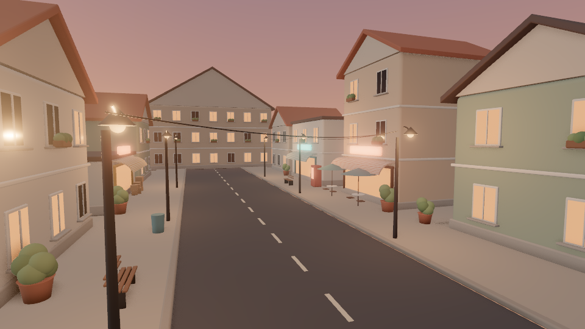 |  |
| A town street at dusk, with soft shading and no outlines | The same street at night in the rain, lamps and windows lit |
| 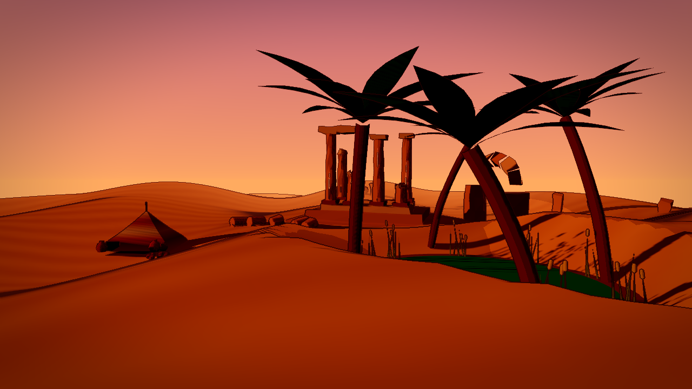 | 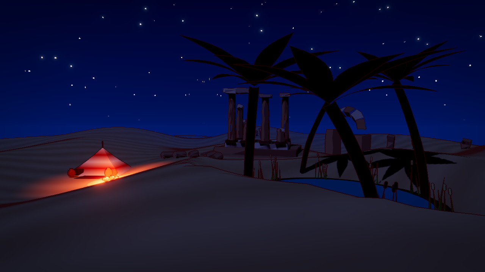 |
| A desert oasis at dusk, drawn with outlines and flat cartoon shading | The same place at night, with a campfire by the tent |
| 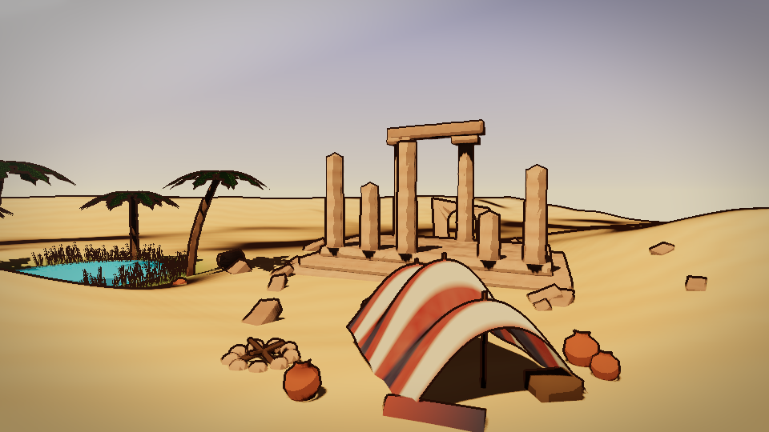 | 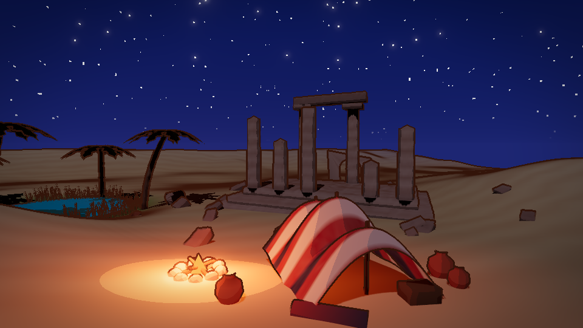 |
| Another desert test at noon | The same camp at night with the fire lit |

## Quick start

You need [Node.js](https://nodejs.org) 20.19+ or 22.12+ (the current LTS is fine).

**A new game, installed from npm:**

```sh
mkdir my-game && cd my-game
npm init -y
npm install threedog three@~0.187.0
npm install -D @threedog/tools
npx threedog init --open-world   # ground, sky, follow camera and a player; never overwrites a file
npm install                      # installs what the new files need
npm run dev                      # open the address it prints
```

**Or from this repository**, where every new game is linked to the engine source:

```sh
git clone https://github.com/penstic123-code/ThreeDog.js-Game-Engine.git
cd ThreeDog.js-Game-Engine
npm install
npm run new-game -- my-game --open-world   # creates games/my-game
npm run dev -- my-game
```

Without `--open-world`, the new game starts as a blank scene with a camera and an empty `style/` folder. It also writes a `CLAUDE.md` and a `.mcp.json`, so Claude Code opened in that folder finds the engine's docs and its MCP server by itself. Existing files are never overwritten.

**Commands an agent uses while the game runs:**

```sh
npx threedog how "day and night cycle"   # which API or recipe answers a task
npx threedog describe --full             # the game's current state as text
npx threedog press interact              # press an action or a key in the running game
npx threedog step 2                      # advance the game by 2 seconds
npx threedog shot                        # a screenshot plus the look check
```

`npx threedog --help` lists every command, and [COMMANDS.md](packages/engine/docs/COMMANDS.md) explains them.

**Working on the engine itself (this repository):**

```sh
npm install
npm run new-game -- my-game --open-world   # creates games/my-game
npm run dev -- my-game
npm run check                              # docs, types and content checks
npm test
```

A minimal game in code, and the two changes the engine makes to three.js globals on import, are in [packages/engine/README.md](packages/engine/README.md).

## Packages

| Package | What it is |
|---|---|
| [`threedog`](packages/engine) | The engine |
| [`@threedog/tools`](packages/tools) | The `threedog` command line, the MCP server and the tools that drive a running game |
| [`@threedog/post-effects`](packages/post-effects) | Optional post effects: color grading, film grain, vignette, depth of field and more |
| [`@threedog/terrain-noise`](packages/terrain-noise) | Optional noise-based terrain: hills, islands, canyons, rivers |

## Status

Version 0.5 is an early release. It runs on WebGL (the default) and WebGPU (`createEngine({ renderer: 'webgpu' })`); APIs may still change. What changed since 0.4 is in the [changelog](packages/engine/CHANGELOG.md), and the upgrade steps, most common first, are in [MIGRATING-0.5.md](packages/engine/docs/MIGRATING-0.5.md).

## Documentation

| File | Content |
|---|---|
| [packages/engine/docs/AI.md](packages/engine/docs/AI.md) | Where an agent starts: one line per task, pointing to the detail |
| [packages/engine/llms.txt](packages/engine/llms.txt) | The standard entry file AI tools look for |
| [packages/engine/docs/recipes/](packages/engine/docs/recipes) | Guides by task: a new game, NPCs, items, quests, weather, Blender models, vehicles, performance |
| [packages/engine/docs/API.md](packages/engine/docs/API.md) | API index, generated from code comments |
| [packages/engine/docs/THREE.md](packages/engine/docs/THREE.md) | Using three.js directly next to the engine |
| [packages/engine/docs/PERF.md](packages/engine/docs/PERF.md) | Measuring performance |

## License

[MIT](LICENSE). The logo is AI-generated; the screenshots are rendered by the engine. Asset details are in [ASSETS.md](ASSETS.md).
