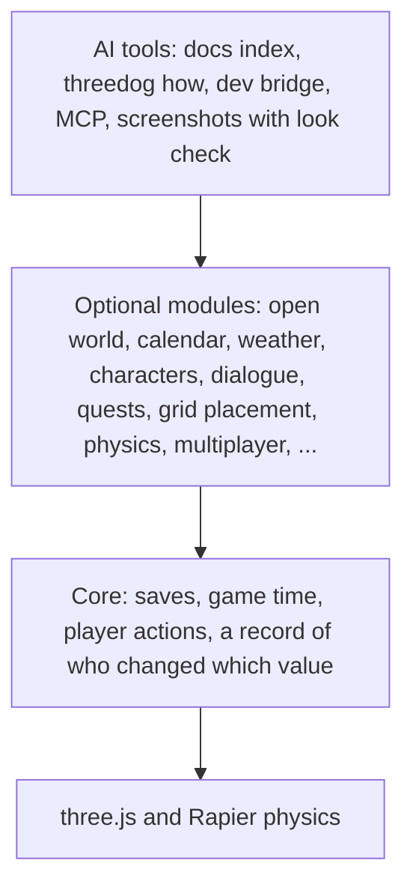

<p align="center">
  
</p>

<h1 align="center">ThreeDog.js</h1>

<p align="center">
  A 3D game engine for the web, built on three.js and made to be used by AI coding agents.
</p>

<p align="center">
  <a href="LICENSE"></a>
</p>

<p align="center">
  English · <a href="README.zh-CN.md">中文</a>
</p>

<p align="center">
  
</p>

## Why it exists

An AI coding agent asked for a three.js game starts from an empty scene. Before it reaches the gameplay it has to write saving and loading, a day and night cycle, lights that follow the time of day, collision and weather, and it writes them again in the next game, a little differently each time. In a small game that only costs time. In a bigger one the pieces start to fight: the weather darkens the sky, the day cycle brightens it back, and a save made at dusk loads at noon.

ThreeDog takes over those systems so they are written once and work together. The agent spends its effort on what makes the game its own, which is the rules and the look.

## Design ideas

**three.js stays directly writable.** Engine objects are ordinary three.js objects, so everything an agent already knows about three.js still applies. When a game sets a value itself, for example a light's intensity, the engine stops writing that value and records that the game now owns it. The game never has to fight the engine for control, and anyone asking "why is this light so bright?" gets an answer naming who set it.

**The engine does three things and no more.** It coordinates systems that would otherwise disagree (time, weather, lights, saves). It takes on engineering that is hard and gets repeated in every game (streaming a large world, physics, pathfinding, saving without losing data). And it lets the agent see and check what it made. Anything three.js already does well, the engine leaves to three.js.

**The engine never decides how a game looks.** Without a game's own style, everything is drawn as neutral gray placeholders. Colors, materials, sky and post effects belong to the game, so a pixel-art farm and a moody city street can sit on the same engine without either one looking like a default.

## Made for AI agents

Each feature below starts from a problem agents actually run into.

| Problem | What the engine does |
|---|---|
| Reading all the docs fills the agent's context before work begins | A one-page index ([AI.md](packages/engine/docs/AI.md)) has one line per task, and `threedog how "rain at night"` returns the one paragraph to read |
| An agent guesses an API from memory and gets it slightly wrong | Errors name the correct form. A removed option such as `sky({ dayLength })` throws an error that points to the module that now owns it |
| Two ways to do one thing, and the agent mixes them | Each task has one recommended entry, listed in a table in [CONVENTIONS.md](packages/engine/docs/CONVENTIONS.md) |
| The agent cannot tell what the running game is doing | `threedog describe` prints the game's state as short text, and `threedog explain` says why an action cannot run (for example, the door is locked and needs a key) |
| Checking a change means asking a person to play | The agent drives the game itself: it presses keys, steps time, runs actions and takes screenshots, from the command line or over MCP (Model Context Protocol, which tools such as Claude Code and Cursor use) |
| An agent cannot judge its own screenshot reliably | Every screenshot comes with a look check that reports facts: which areas are blown out or too dark, which light is likely the cause and its current value. It never suggests target values, because the look belongs to the game |

## Architecture

The engine has four layers. A game installs only the modules it uses, and at every layer it can still write three.js directly.



Player actions go through one named-operation API (`engine.ops`) whether a player, an NPC or the agent triggers them, so each one can be checked before it runs, logged, undone and replayed.

## Gallery

These screenshots come from games an AI agent built with the engine in 15-minute look tests. Nothing has been retouched. The two sets use different styles, and the style is written by the game, not shipped by the engine.

| | |
|---|---|
|  |  |
| A town street at dusk, with soft shading and no outlines | The same street at night in the rain, lamps and windows lit |
|  |  |
| A desert oasis at dusk, drawn with outlines and flat cartoon shading | The same place at night, with a campfire by the tent |
|  |  |
| Another desert test at noon | The same camp at night with the fire lit |

## Quick start

You need [Node.js](https://nodejs.org) (LTS).

**A new game:**

```sh
git clone https://github.com/penstic123-code/ThreeDog.js-Game-Engine.git
cd ThreeDog.js-Game-Engine
npm install
npm run new-game -- my-game --open-world   # creates games/my-game: ground, sky, follow camera, a player
npm run dev -- my-game                     # open the address it prints
```

The engine is not on npm yet; for now you use it from this repository.

Without `--open-world`, the new game starts as a blank scene with a camera and an empty `style/` folder. It also writes a `CLAUDE.md` and a `.mcp.json`, so Claude Code opened in that folder finds the engine's docs and its MCP server by itself. Existing files are never overwritten.

**Commands an agent uses while the game runs:**

```sh
npx threedog how "day and night cycle"   # which API or recipe answers a task
npx threedog describe --full             # the game's current state as text
npx threedog press interact              # press an action or a key in the running game
npx threedog step 2                      # advance the game by 2 seconds
npx threedog shot                        # a screenshot plus the look check
```

`npx threedog --help` lists every command, and [COMMANDS.md](packages/engine/docs/COMMANDS.md) explains them.

**Working on the engine itself (this repository):**

```sh
npm install
npm run new-game -- my-game --open-world   # creates games/my-game
npm run dev -- my-game
npm run check                              # docs, types and content checks
npm test
```

A minimal game in code, and the two changes the engine makes to three.js globals on import, are in [packages/engine/README.md](packages/engine/README.md).

## Packages

| Package | What it is |
|---|---|
| [`threedog`](packages/engine) | The engine |
| [`@threedog/tools`](packages/tools) | The `threedog` command line, the MCP server and the tools that drive a running game |
| [`@threedog/post-effects`](packages/post-effects) | Optional post effects: color grading, film grain, vignette, depth of field and more |
| [`@threedog/terrain-noise`](packages/terrain-noise) | Optional noise-based terrain: hills, islands, canyons, rivers |

## Status

Version 0.4 is an early release. It runs on WebGL (the default) and WebGPU (`createEngine({ renderer: 'webgpu' })`); APIs may still change. What changed since 0.3 is in the [changelog](packages/engine/CHANGELOG.md), and the upgrade steps, most common first, are in [MIGRATING-0.4.md](packages/engine/docs/MIGRATING-0.4.md).

## Documentation

| File | Content |
|---|---|
| [packages/engine/docs/AI.md](packages/engine/docs/AI.md) | Where an agent starts: one line per task, pointing to the detail |
| [packages/engine/llms.txt](packages/engine/llms.txt) | The standard entry file AI tools look for |
| [packages/engine/docs/recipes/](packages/engine/docs/recipes) | Guides by task: a new game, NPCs, items, quests, weather, Blender models, vehicles, performance |
| [packages/engine/docs/API.md](packages/engine/docs/API.md) | API index, generated from code comments |
| [packages/engine/docs/THREE.md](packages/engine/docs/THREE.md) | Using three.js directly next to the engine |
| [packages/engine/docs/PERF.md](packages/engine/docs/PERF.md) | Measuring performance |

## License

[MIT](LICENSE). The logo is AI-generated; the screenshots are rendered by the engine. Asset details are in [ASSETS.md](ASSETS.md).
