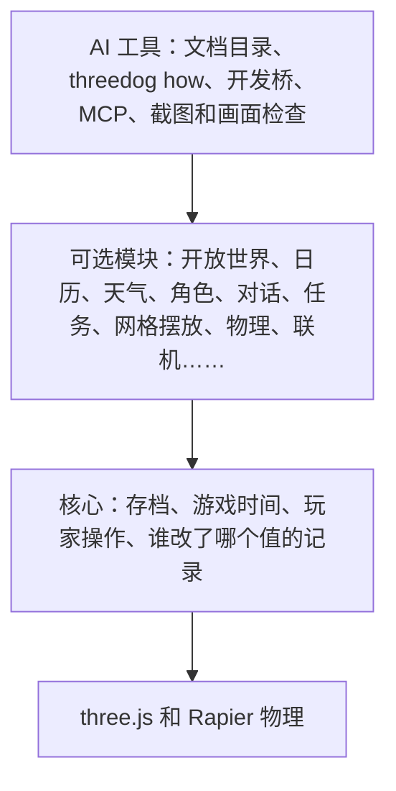

<p align="center">
  
</p>

<h1 align="center">ThreeDog.js</h1>

<p align="center">
  建在 three.js 上的网页 3D 游戏引擎，专门给 AI 编程助手用。
</p>

<p align="center">
  <a href="LICENSE"></a>
</p>

<p align="center">
  <a href="README.md">English</a> · 中文
</p>

<p align="center">
  
</p>

## 为什么要有它

让 AI 编程助手用 three.js 写一个游戏，它面对的是一个空场景。还没碰到玩法，它就得先写存档读档、昼夜交替、跟着时间变化的灯光、碰撞和天气；换一个游戏，这些又从头写一遍，每次写法都不太一样。小游戏里这只是费时间，游戏一大，各部分就开始互相打架：天气把天色压暗，昼夜系统又把它调亮，黄昏存的档读出来变成了正午。

ThreeDog 把这些系统接过来，写一次，并且让它们彼此配合。AI 的力气就能花在这个游戏自己的东西上，也就是玩法和画面。

## 设计思路

**three.js 始终可以直接写。** 引擎里的对象就是普通的 three.js 对象，AI 已经会的 three.js 知识全都照用。游戏自己改了某个值，比如一盏灯的亮度，引擎就不再写这个值，并记下它现在归游戏管。游戏不用跟引擎抢控制权；有人问"这盏灯怎么这么亮"，也能查到是谁设的。

**引擎只做三件事。** 它协调那些各管各就会冲突的系统，比如时间、天气、灯光和存档。它接下又难、每个游戏又都要重写的工程活，比如大世界分区加载、物理、寻路和不丢数据的存档。它还让 AI 看得见、查得了自己做出来的东西。three.js 本来就做得好的，引擎不重复做。

**引擎从不决定游戏长什么样。** 游戏没给自己的画风时，一切都画成中性的灰色占位。颜色、材质、天空、后期效果都属于游戏自己，所以像素风的农场和阴郁的城市街道可以用同一个引擎，谁也不会带着一股"默认画面"的味道。

## 为 AI 设计

下面每一项都从 AI 真实遇到的问题出发。

| 问题 | 引擎怎么做 |
|---|---|
| 把文档全读一遍，还没开工上下文就满了 | 一页目录（[AI.md](packages/engine/docs/AI.md)）每个任务一行；`threedog how "rain at night"` 直接给出该读的那一段 |
| AI 凭记忆猜接口，常常差一点 | 报错里写着正确写法。比如已经移走的选项 `sky({ dayLength })`，报错会指向现在负责它的模块 |
| 同一件事有两种做法，AI 会混着用 | 每个任务只推荐一个入口，列在 [CONVENTIONS.md](packages/engine/docs/CONVENTIONS.md) 的一张表里 |
| AI 不知道运行中的游戏正在发生什么 | `threedog describe` 把游戏状态写成简短的文字；`threedog explain` 说明某个操作为什么做不了（比如门锁着，需要钥匙） |
| 检查一次改动，就得找人来玩 | AI 自己操作游戏：按键、推进时间、执行操作、截图，用命令行或 MCP 都行（MCP 是模型上下文协议，Claude Code、Cursor 这类工具用它调用外部工具） |
| AI 看自己的截图，判断不可靠 | 每张截图都附带一次画面检查，只报事实：哪里过曝、哪里太暗，可能是哪盏灯造成的，它现在的值是多少。检查从不给目标值，因为画面由游戏自己决定 |

## 架构

引擎分四层。游戏只装自己用到的模块，而且在任何一层都可以直接写 three.js。



玩家、NPC 和 AI 触发的操作都走同一套命名操作接口（`engine.ops`），所以每个操作都能先检查能不能做，再执行、记录、撤销和重放。

## 截图

下面的截图来自 AI 用这个引擎做的游戏，每个都是 15 分钟的画面测试，没有任何后期修图。两组用的是不同画风，画风由游戏自己写，不是引擎自带的。

| | |
|---|---|
|  |  |
| 黄昏的小镇街道，柔和着色，没有描边 | 同一条街的雨夜，路灯和窗户亮着 |
|  |  |
| 黄昏的沙漠绿洲，用描边和平涂的卡通着色 | 同一个地方的夜晚，帐篷边点着篝火 |
|  |  |
| 另一次沙漠测试，正午 | 同一个营地的夜晚，篝火点着 |

## 快速开始

先安装 [Node.js](https://nodejs.org)（LTS 版本）。

**新建一个游戏：**

```sh
git clone https://github.com/penstic123-code/ThreeDog.js-Game-Engine.git
cd ThreeDog.js-Game-Engine
npm install
npm run new-game -- my-game --open-world   # 新建 games/my-game：地形、天空、跟随相机和一个玩家
npm run dev -- my-game                     # 打开它打印出来的地址
```

引擎暂时还没有发布到 npm，目前从这个仓库直接使用。

不加 `--open-world` 时，新游戏只有一个带相机的空场景和一个空的 `style/` 文件夹。它还会写 `CLAUDE.md` 和 `.mcp.json`，在这个文件夹里打开 Claude Code，它自己就能找到引擎的文档和 MCP 服务。已经存在的文件不会被覆盖。

**游戏运行时 AI 常用的命令：**

```sh
npx threedog how "day and night cycle"   # 某个任务该用哪个接口、看哪篇教程
npx threedog describe --full             # 把游戏现在的状态写成文字
npx threedog press interact              # 在运行中的游戏里按一个操作或按键
npx threedog step 2                      # 让游戏往前走 2 秒
npx threedog shot                        # 截图，附带画面检查
```

`npx threedog --help` 列出所有命令，[COMMANDS.md](packages/engine/docs/COMMANDS.md) 有逐条说明。`how` 按英文文档检索，任务描述请用英文写。

**开发引擎本身（这个仓库）：**

```sh
npm install
npm run new-game -- my-game --open-world   # 新建 games/my-game
npm run dev -- my-game
npm run check                              # 检查文档、类型和内容
npm test
```

用代码写一个最小游戏的例子，以及引擎在导入时对 three.js 做的两处全局改动，见 [packages/engine/README.md](packages/engine/README.md)。

## 包

| 包 | 是什么 |
|---|---|
| [`threedog`](packages/engine) | 引擎本体 |
| [`@threedog/tools`](packages/tools) | `threedog` 命令行、MCP 服务，以及操作运行中游戏的工具 |
| [`@threedog/post-effects`](packages/post-effects) | 可选的后期效果：调色、胶片颗粒、暗角、景深等 |
| [`@threedog/terrain-noise`](packages/terrain-noise) | 可选的噪声地形：丘陵、海岛、峡谷、河流 |

## 现状

0.4 是早期版本，可以跑在 WebGL（默认）和 WebGPU（`createEngine({ renderer: 'webgpu' })`）上，接口还可能变。和 0.3 相比改了什么，见[更新日志](packages/engine/CHANGELOG.md)；老游戏怎么升级，按常见程度排好的步骤在 [MIGRATING-0.4.md](packages/engine/docs/MIGRATING-0.4.md)。

## 文档

文档以英文为主。

| 文件 | 内容 |
|---|---|
| [packages/engine/docs/AI.md](packages/engine/docs/AI.md) | AI 从这里开始读：每个任务一行，指向详细说明 |
| [packages/engine/llms.txt](packages/engine/llms.txt) | AI 工具会自动找的标准入口文件 |
| [packages/engine/docs/recipes/](packages/engine/docs/recipes) | 按任务写的教程：新游戏、NPC、物品、任务、天气、Blender 模型、载具、性能…… |
| [packages/engine/docs/API.md](packages/engine/docs/API.md) | 接口索引，从代码注释生成 |
| [packages/engine/docs/THREE.md](packages/engine/docs/THREE.md) | 在引擎旁边直接用 three.js |
| [packages/engine/docs/PERF.md](packages/engine/docs/PERF.md) | 怎么测性能 |

## 许可证

[MIT](LICENSE)。标志由 AI 生成，截图由引擎渲染，素材来源见 [ASSETS.md](ASSETS.md)。
