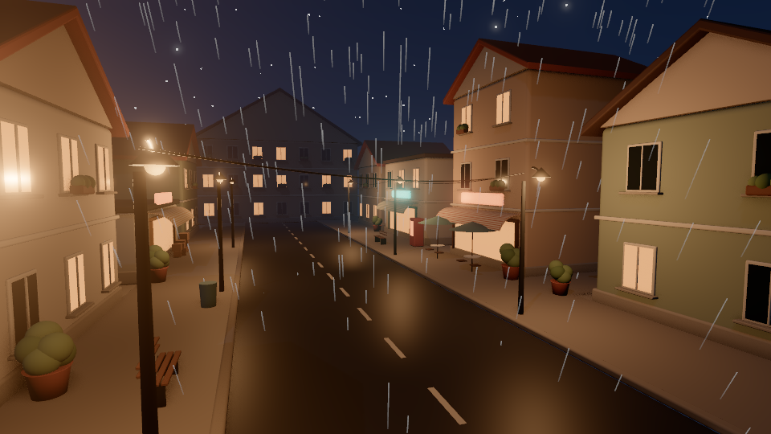
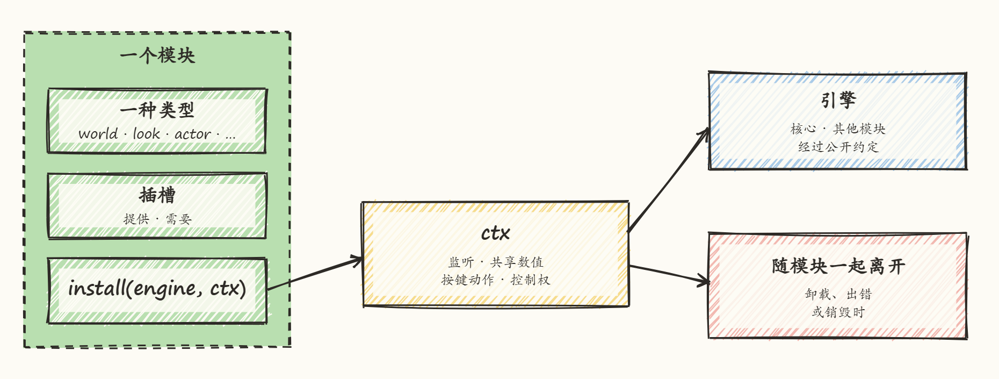
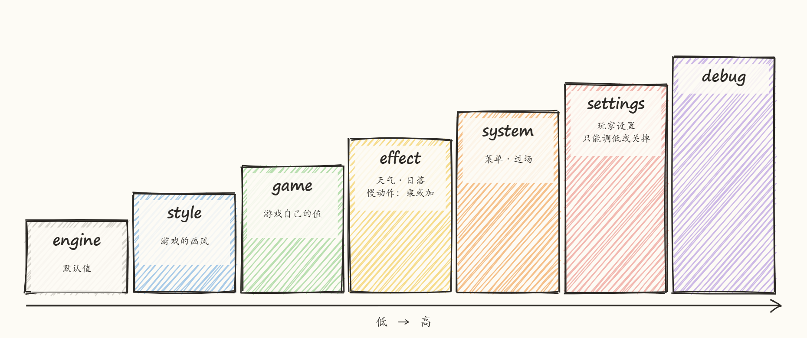
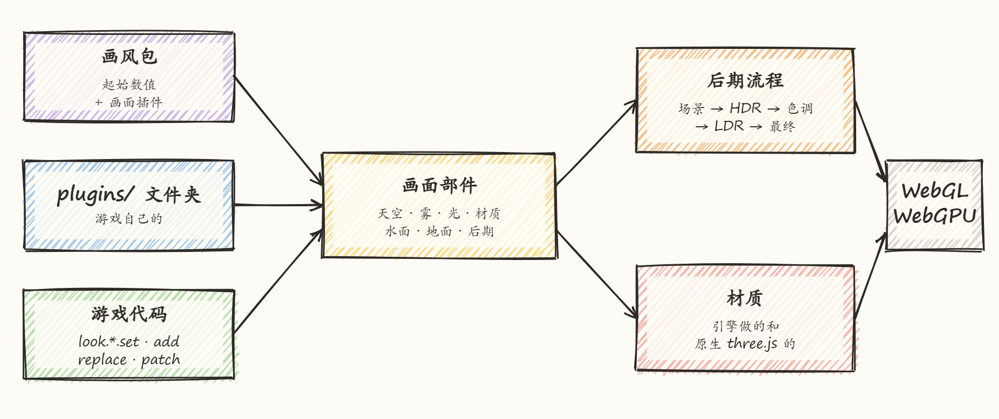
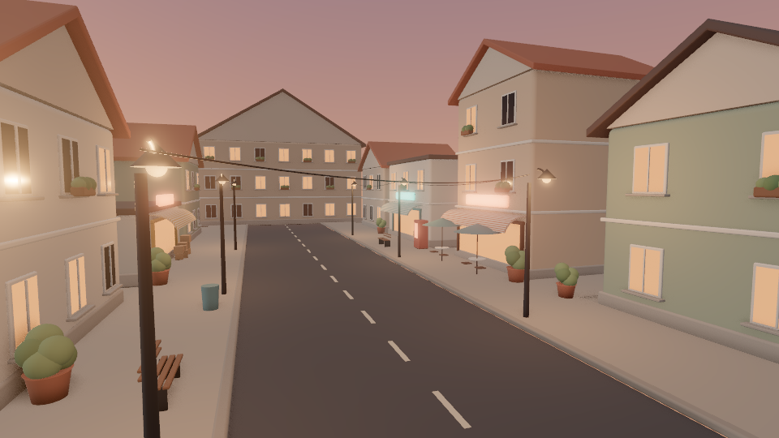
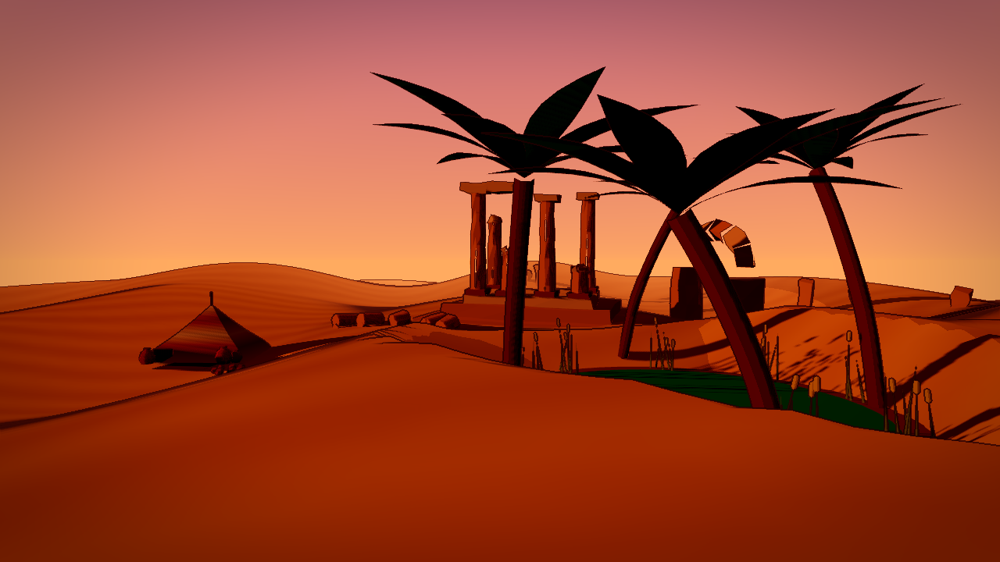
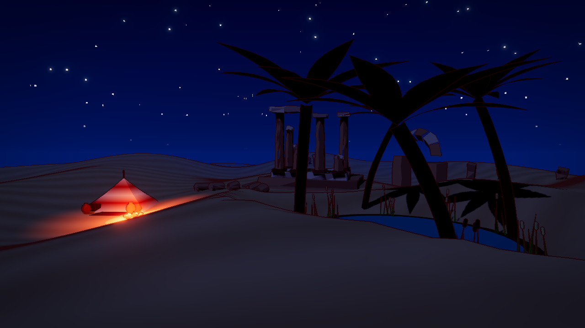
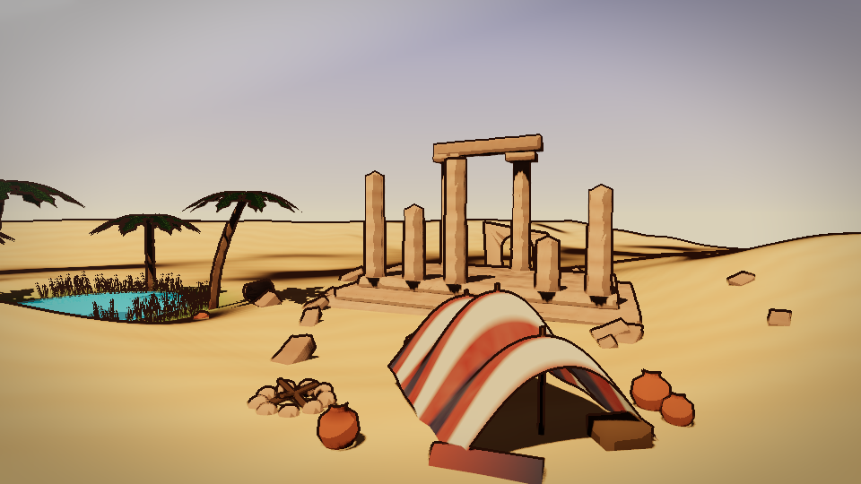
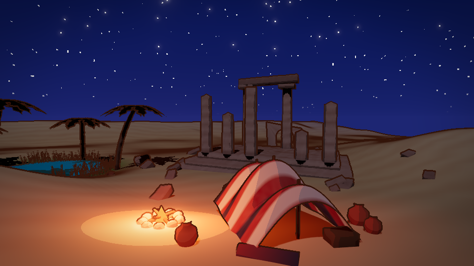

<p align="center">
  
</p>

<h1 align="center">ThreeDog.js</h1>

<p align="center">
  建在 three.js 上的网页 3D 游戏引擎，专门给 AI 编程助手用。
</p>

<p align="center">
  <a href="LICENSE"></a>
</p>

<p align="center">
  <a href="README.md">English</a> · 中文
</p>

<p align="center">
  
</p>

## 为什么要有它

让 AI 编程助手用 three.js 写一个游戏，它面对的是一个空场景。还没碰到玩法，它就得先写存档读档、昼夜交替、跟着时间变化的灯光、碰撞和天气；换一个游戏，这些又从头写一遍，每次写法都不太一样。小游戏里这只是费时间，游戏一大，各部分就开始互相打架：天气把天色压暗，昼夜系统又把它调亮，黄昏存的档读出来变成了正午。

ThreeDog 把这些系统接过来，写一次，并且让它们彼此配合。AI 的力气就能花在这个游戏自己的东西上，也就是玩法和画面。

## 设计思路

<p align="center"></p>

**一块留好插槽的底板，而不是一套要重新学的框架。** 引擎里的对象就是普通的 three.js 对象，AI 已经会的 three.js 知识全都照用。引擎留好了插槽：天空、某种用途的材质、一个后期效果、背包或天气这样的模块。AI 用原生 three.js 写的东西，只要引擎看得出意图（加进场景、新建一盏灯、加一个后期通道、把文件放进 `plugins/`），就会自动接到对应的插槽上；看不出意图的地方，只需要写一行。

**引擎从不和游戏抢。** 游戏自己写了某个值，比如一盏灯的亮度或场景的雾，引擎就不再写它，并记下它现在归游戏管。引擎对 three.js 本身做的每一处改动都列了出来，随时可以查看。

**引擎只做三件事。** 它协调那些各管各就会冲突的系统，比如时间、天气、灯光和存档。它接下又难、每个游戏又都要重写的工程活，比如大世界分区加载、物理、寻路和不丢数据的存档。它还让 AI 看得见、查得了自己做出来的东西。three.js 本来就做得好的，引擎不重复做。

**每件事只有一种做法。** 每个任务只有一个入口。更好的入口取代旧入口时，旧的会删掉，再用就会报错，并给出新写法。

**引擎从不决定游戏长什么样。** 游戏没给自己的画风时，一切都画成中性的灰色占位。颜色、材质、天空、后期效果都属于游戏自己，所以风格完全不同的游戏可以用同一个引擎，谁也不会带着一股"默认画面"的味道。

## 为 AI 设计

下面每一项都从 AI 真实遇到的问题出发。

| 问题 | 引擎怎么做 |
|---|---|
| 把文档全读一遍，还没开工上下文就满了 | 一页目录（[AI.md](packages/engine/docs/AI.md)）每个任务一行；`threedog how "rain at night"` 直接给出该读的那一段 |
| AI 凭记忆猜接口，常常差一点 | 报错里写着正确写法。比如已经移走的选项 `sky({ dayLength })`，报错会指向现在负责它的模块 |
| 同一件事有两种做法，AI 会混着用 | 每个任务只推荐一个入口，列在 [CONVENTIONS.md](packages/engine/docs/CONVENTIONS.md) 的一张表里 |
| AI 不知道运行中的游戏正在发生什么 | `threedog describe` 把游戏状态写成简短的文字；`threedog explain` 说明某个操作为什么做不了（比如门锁着，需要钥匙） |
| 检查一次改动，就得找人来玩 | AI 自己操作游戏：按键、推进时间、执行操作、截图，用命令行或 MCP 都行（MCP 是模型上下文协议，Claude Code、Cursor 这类工具用它调用外部工具） |
| AI 看自己的截图，判断不可靠 | 每张截图都附带一次画面检查，只报事实：哪里过曝、哪里太暗，可能是哪盏灯造成的，它现在的值是多少。检查从不给目标值，因为画面由游戏自己决定 |

## 架构

<p align="center"></p>

- **你的游戏**放规则、内容、画风和插件，以及它直接写的 three.js。
- **核心**管每个游戏都有、而且绝不能互相打架的东西：生命周期（没准备好的东西不会运行）、统一的时间来源（慢动作和暂停都只是它的不同读法）、带主人的数值、按场合分组的按键（菜单和对话是压上一层场合，而不是锁住按键）、每个角色只有一个控制者、读档失败能干净回滚的存档，以及能先检查、再记录、可以重放的玩家操作。
- **模块**在核心之上加功能，游戏只装自己用到的。
- **渲染**让引擎自带的内容在 WebGL 和 WebGPU 上都能跑。引擎自带的每个画面效果都有两种写法，只写了一种的会被检查拦下。
- **给 AI 的工具**（`threedog how`、`describe`、`test`、`shot` 和 MCP 服务）让 AI 能操作正在运行的游戏、读取它的状态。

### 什么是模块

模块就是一项功能，并且声明了自己的类型。它只通过核心和公开的约定跟引擎其他部分打交道，所以可以单独卸下或换掉，不影响别的。

<p align="center"></p>

| 类型 | 管什么 |
|---|---|
| `world` | 世界的状态：地形数据、日历、天气数据。不画任何东西 |
| `look` | 东西看起来什么样：天空、地形外观、水面、效果。它出错不会让游戏停下 |
| `actor` | 角色，以及让角色动起来的东西 |
| `rules` | 玩法：背包、任务、交互，都通过经过检查的玩家操作 |
| `ui` | 菜单、界面、设置。它出错不会让游戏停下 |
| `net` | 联机 |
| `tool` | 开发辅助 |

自己写的模块和引擎自带的写法一样，待遇也一样。`engine.use(mine(), { replaces: 'inventory' })` 就能用自己的模块换掉引擎自带的，还有一个约定检查，确认替换品提供了引擎其他部分会调用的全部方法。

### 几个主人怎么共用一个值

太阳亮度、雾的远近、时间快慢，常常有好几处同时想改。引擎不让它们各写各的、互相覆盖，而是让每个写入者在某一层上登记一条，引擎再用还在的条目重新算出结果。

<p align="center"></p>

从低到高依次是：引擎默认值、游戏的画风、游戏自己的值、天气日落慢动作这类临时效果（乘或加）、菜单和过场、玩家设置（只能调低或关掉），最后是调试。

- 效果结束时只要拿掉自己那一条，所以效果可以按任意顺序结束，不会留下过时的值。
- 玩家设置排在菜单和过场之上，游戏怎么做都打不开玩家关掉的东西。
- 两个主人在同一层设同一个值，开发时直接报错；`describe()` 能看到每个值是谁写的。

### 画面是怎么拼起来的

<p align="center"></p>

画风包就是一个文件夹，里面放起始数值和画面插件。同一个插件可以单独用，也可以放进好几个画风包，走的都是和游戏自己的 `plugins/` 文件夹相同的路。每个画面部件都只认同一小组动作（`set`、`patch`、`add`、`replace`、`manual`、`value`），后期效果在各自的阶段里位置固定。

## 截图

下面的截图来自 AI 用这个引擎做的游戏，每个都是 15 分钟的画面测试，没有任何后期修图。两组用的是不同画风，画风由游戏自己写，不是引擎自带的。

| | |
|---|---|
|  |  |
| 黄昏的小镇街道，柔和着色，没有描边 | 同一条街的雨夜，路灯和窗户亮着 |
|  |  |
| 黄昏的沙漠绿洲，用描边和平涂的卡通着色 | 同一个地方的夜晚，帐篷边点着篝火 |
|  |  |
| 另一次沙漠测试，正午 | 同一个营地的夜晚，篝火点着 |

## 快速开始

先安装 [Node.js](https://nodejs.org) 20.19 及以上或 22.12 及以上（当前的 LTS 版本就行）。

**新建一个游戏，从 npm 安装：**

```sh
mkdir my-game && cd my-game
npm init -y
npm install threedog three@~0.187.0
npm install -D @threedog/tools
npx threedog init --open-world   # 地形、天空、跟随相机和一个玩家；不覆盖已有文件
npm install                      # 装上新文件用到的依赖
npm run dev                      # 打开它打印出来的地址
```

**或者用这个仓库**，新游戏会直接连到引擎源码：

```sh
git clone https://github.com/penstic123-code/ThreeDog.js-Game-Engine.git
cd ThreeDog.js-Game-Engine
npm install
npm run new-game -- my-game --open-world   # 新建 games/my-game
npm run dev -- my-game
```

不加 `--open-world` 时，新游戏只有一个带相机的空场景和一个空的 `style/` 文件夹。它还会写 `CLAUDE.md` 和 `.mcp.json`，在这个文件夹里打开 Claude Code，它自己就能找到引擎的文档和 MCP 服务。已经存在的文件不会被覆盖。

**游戏运行时 AI 常用的命令：**

```sh
npx threedog how "day and night cycle"   # 某个任务该用哪个接口、看哪篇教程
npx threedog describe --full             # 把游戏现在的状态写成文字
npx threedog press interact              # 在运行中的游戏里按一个操作或按键
npx threedog step 2                      # 让游戏往前走 2 秒
npx threedog shot                        # 截图，附带画面检查
```

`npx threedog --help` 列出所有命令，[COMMANDS.md](packages/engine/docs/COMMANDS.md) 有逐条说明。`how` 按英文文档检索，任务描述请用英文写。

**开发引擎本身（这个仓库）：**

```sh
npm install
npm run new-game -- my-game --open-world   # 新建 games/my-game
npm run dev -- my-game
npm run check                              # 检查文档、类型和内容
npm test
```

用代码写一个最小游戏的例子，以及引擎在导入时对 three.js 做的两处全局改动，见 [packages/engine/README.md](packages/engine/README.md)。

## 包

| 包 | 是什么 |
|---|---|
| [`threedog`](packages/engine) | 引擎本体 |
| [`@threedog/tools`](packages/tools) | `threedog` 命令行、MCP 服务，以及操作运行中游戏的工具 |
| [`@threedog/post-effects`](packages/post-effects) | 可选的后期效果：调色、胶片颗粒、暗角、景深等 |
| [`@threedog/terrain-noise`](packages/terrain-noise) | 可选的噪声地形：丘陵、海岛、峡谷、河流 |

## 现状

0.5 是早期版本，可以跑在 WebGL（默认）和 WebGPU（`createEngine({ renderer: 'webgpu' })`）上，接口还可能变。和 0.4 相比改了什么，见[更新日志](packages/engine/CHANGELOG.md)；老游戏怎么升级，按常见程度排好的步骤在 [MIGRATING-0.5.md](packages/engine/docs/MIGRATING-0.5.md)。

## 文档

文档以英文为主。

| 文件 | 内容 |
|---|---|
| [packages/engine/docs/AI.md](packages/engine/docs/AI.md) | AI 从这里开始读：每个任务一行，指向详细说明 |
| [packages/engine/llms.txt](packages/engine/llms.txt) | AI 工具会自动找的标准入口文件 |
| [packages/engine/docs/recipes/](packages/engine/docs/recipes) | 按任务写的教程：新游戏、NPC、物品、任务、天气、Blender 模型、载具、性能…… |
| [packages/engine/docs/API.md](packages/engine/docs/API.md) | 接口索引，从代码注释生成 |
| [packages/engine/docs/THREE.md](packages/engine/docs/THREE.md) | 在引擎旁边直接用 three.js |
| [packages/engine/docs/PERF.md](packages/engine/docs/PERF.md) | 怎么测性能 |

## 许可证

[MIT](LICENSE)。标志由 AI 生成，截图由引擎渲染，素材来源见 [ASSETS.md](ASSETS.md)。
