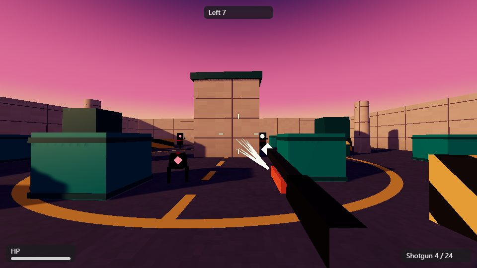
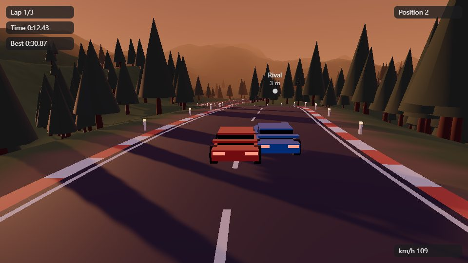
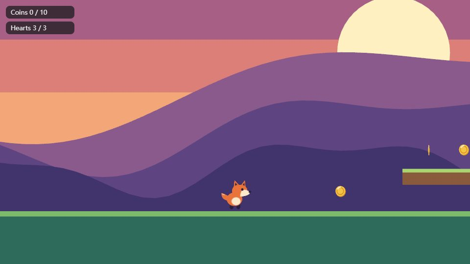
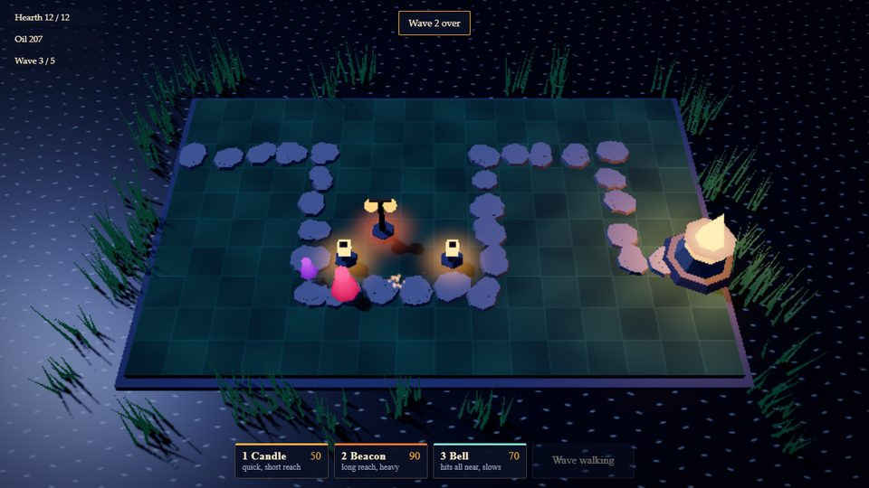
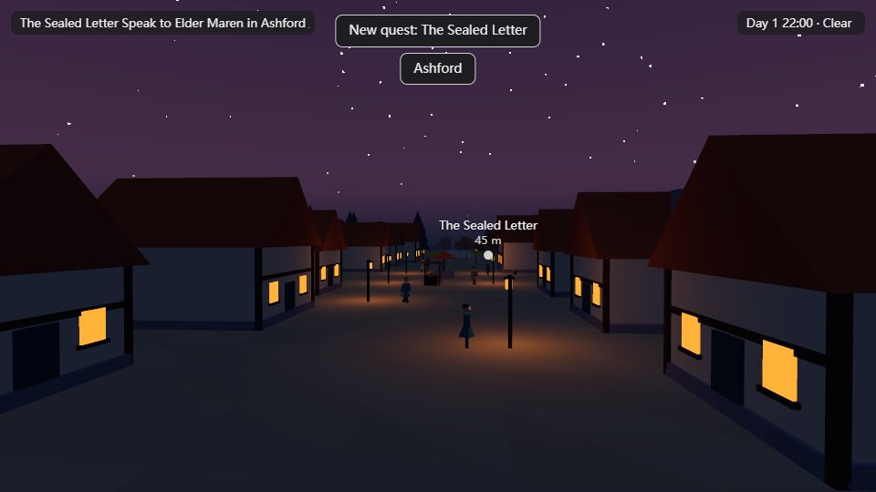
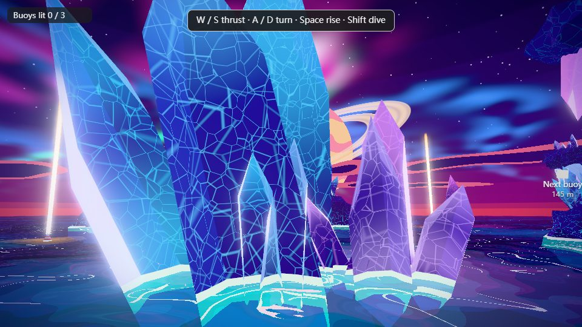
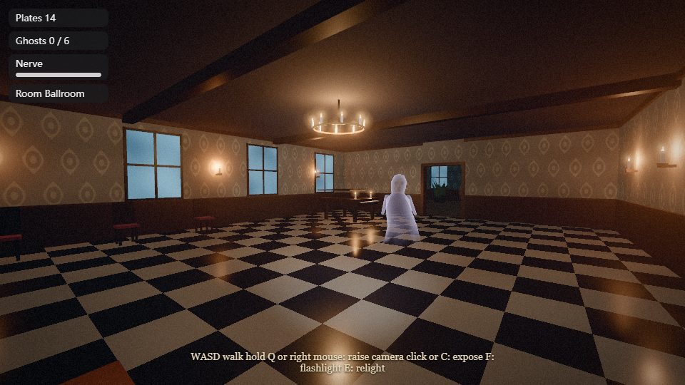
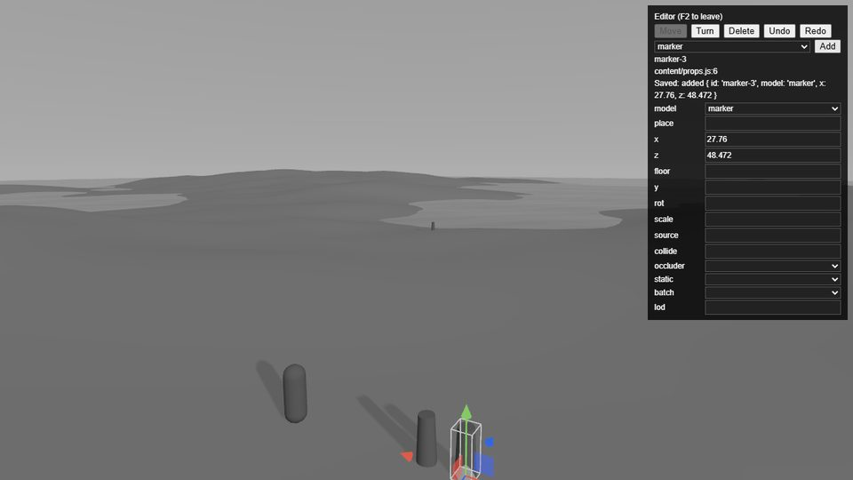
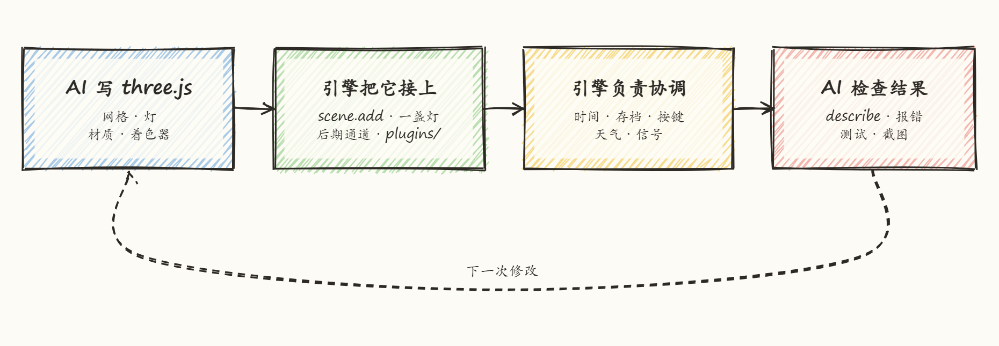
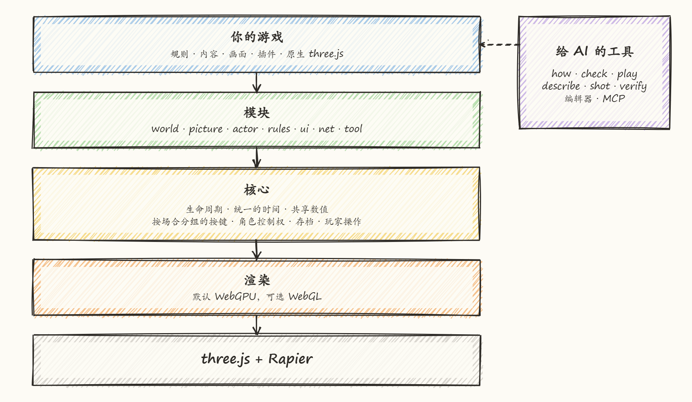

<p align="center">
  
</p>

<h1 align="center">Threedog.js</h1>

<p align="center">
  让 AI 在 three.js 上做网页游戏的引擎。
</p>

<p align="center">
  <a href="LICENSE"></a>
</p>

<p align="center">
  <a href="README.md">English</a> · 中文
</p>

## 这是什么

ThreeDog.js 是为 AI 助手打造的游戏引擎。它建在 three.js 上，负责游戏规则和画面之外的一切：固定时间步、输入、存档、物理、内容、大世界流式加载、浏览器内编辑器，以及助手用来检查自己工作的工具。

一切仍然是 three.js。引擎里的对象就是普通的 three.js 对象，`scene.add`、材质和着色器照常使用，游戏直接写下的值立刻生效。引擎让各个系统保持一致：读档恢复天气，过场动画让玩家停下，新加载的世界进入物理系统。

画面和手感属于游戏。引擎没有默认风格，新游戏从中性的灰色占位开始，由自己的 `picture/` 文件夹用普通 three.js 画出来。下面的游戏都跑在同一个引擎上。

## 七个测试游戏和编辑器

| | |
|---|---|
|  |  |
| 第一人称射击 | 赛车 |
|  |  |
| 2D 横版 | 塔防 |
|  |  |
| 开放世界 | 风格化着色器 |
|  |  |
| 恐怖 | 浏览器内编辑器 |

每个游戏都由 AI 助手按一段简短需求做成，包括美术在内用时约 30 到 60 分钟，并由脚本从头玩到尾。所有画面都来自助手写的代码。

## AI 怎样做一个游戏

`threedog init` 写好一个助手一看就能上手的文件夹，里面还有给助手的说明和接工具的配置：

```text
main.js      把模块和系统接起来
game/        规则，每个系统一个文件（武器、敌人、波次）
content/     什么东西放在哪，物品、NPC、任务，都是存档读得懂的数据
picture/     画面，用普通 three.js 写
plugins/     单文件的 three.js 小件，放进去就生效
CLAUDE.md    在这个游戏里怎么干活；.mcp.json 接上工具
```

游戏时间在 `engine.onFixed` 里按固定步长走，伤害、冷却和敌人 AI 都写在这里；动画、相机和界面每帧更新。画面代码不用请引擎代画什么。引擎每帧给出一些普通的值，比如现在几点、雨下得多大，游戏再把它们写成普通的 three.js：

```js
engine.onRender(() => {
  sun.intensity = palette.sun * engine.uniforms.uDaylight.value;
});
```

<p align="center"></p>

助手通过 `threedog` 命令行干活，同样的工具也能走 MCP（Model Context Protocol，Claude Code、Cursor 这类工具用的协议）：

| 命令 | 助手拿到什么 |
|---|---|
| `threedog how "rain at night"` | 文档里回答这件事的那一节，不用通读全部文档 |
| `threedog check` | 规则、类型、内容和引擎 API 误用的检查，最后一行说通过或失败 |
| `threedog play` | 一个跑起来、助手能操作的游戏页面，`press`、`step`、`op` 都作用在它上面 |
| `threedog describe` | 运行中游戏的状态，写成短文字：玩家、时间、天气、相机、开着的窗口 |
| `threedog shot --play` | 一张截图和一份只报事实的画面检查，比如哪块过曝、可能是哪盏灯造成的 |
| `threedog verify <scenario>` | 按 `tests/scenarios/` 里的脚本跑一遍，给出 PASS 或 FAIL、测了什么、没测什么 |

这些工具让助手能自己验证结果。它可以按键、推进游戏时间、执行玩家动作，再把结果读成文字，全程不需要有人坐在键盘前。报错会写明违反了哪条规则、该抄哪一行，`verify` 会把没跑到的动作和跑过的列在一起。画面检查只报事实，从不建议目标数值，因为画面归游戏所有。

## 里面有什么

<p align="center"></p>

游戏只安装用得到的模块，自己写的模块和内置模块待遇相同。

| 方面 | 内容 |
|---|---|
| 游戏流程 | 固定步长循环，唯一的时间来源（慢动作和暂停都是它的视图），读档失败能回滚的存档和自动存档，场景流程，过场动画 |
| 输入和相机 | 按情境分组的动作、改键、手柄；跟随、第一人称、固定、策略和横版相机 |
| 世界 | 数据化的内容、模板、流式加载、地形、格子摆放、植被、水、天空、天气、日历、导航网格和寻路 |
| 物理 | Rapier 刚体和关节、布娃娃、载具、碰撞、射线和鼠标拾取 |
| 玩法 | 带检查的玩家动作、NPC、对话、任务、背包、商店、拾取物，以及管理成百个同类运动物体的 `engine.swarm` |
| 画面辅助 | 级联阴影、大量灯光的灯池、后期效果链、烘焙光照探针、光照贴图、遮挡剔除 |
| 界面和声音 | HUD、菜单、设置、多语言、拍照模式、音效、音乐、环境声 |
| 工具 | 命令行、MCP 服务器、能写回内容文件的浏览器编辑器、资源优化、压力和性能测试 |

新游戏默认走 WebGPU 和 TSL（three.js 的节点着色语言）。浏览器没有 WebGPU 时，同一个游戏改由 three.js 的 WebGL2 后端运行，速度慢一些。`--webgl` 让游戏一开始就走 GLSL 着色器。这个选择要放在最前面，因为两条路线的画面代码写法不同，以后换就得重写。少数效果（`voxelGI`、`temporalAA`、`sunShafts`、`lightVolumes`）只有 TSL 版本。

## 成果

**完整的游戏。** 按简短需求做出七个游戏，每个约 30 到 60 分钟。最新的三个（射击、赛车、2D 平台）只用随包文档和工具完成，引擎没有改动，规则都按系统分成了独立文件。[第一轮记录](docs/testing/capability/composite-round-1.md)。

**单项任务。** [85 项任务](docs/testing/capability/)覆盖引擎的模块和命令组，每项由脚本或指定截图判定。第一轮通过 76 项，其余都进入了之后的引擎修复。

**大型城市。** 在一台 RTX 5060 笔记本上，WebGPU，1280×720：一座 1.9 km 见方的城（约 6400 栋楼、7.2 万个网格），1.4 万辆车和行人同时走动，加 200 个 NPC 和 8 盏真灯，约 60 fps，测量时机器还被其他测试占满。上限由运动物体决定：2.8 万个时为 26 到 35 fps，地图扩大四倍帧时间不变。走 10 分钟没有泄漏，12 轮存读档全部正确。[完整报告](docs/testing/field/2026-11-05-city/acceptance.md)。

**测试集。** 836 项、6130 个检查，全部通过。每次推送，CI 都会跑静态检查、一组浏览器测试和构建。

## 现状

1.0 已经很近。npm 上是 0.7.0，`main` 比它新，这一页写的是 `main`，包括编辑器和 `engine.swarm`。1.0 之前名字还可能调整。

ThreeDog 运行在 Windows 和 Linux 的桌面浏览器上。Mac 支持在 1.0 之后。多人联机不是目标。

## 快速开始

需要 [Node.js](https://nodejs.org) 20.19+ 或 22.12+。下面的步骤从 npm 安装 0.7.0：

```sh
mkdir my-game && cd my-game
npm init -y
npm install threedog three@~0.187.0
npm install -D @threedog/tools
npx threedog init --open-world   # 地面、天空、跟随相机和玩家；不会覆盖已有文件
npm install                      # 安装新文件需要的依赖
npm run dev                      # 打开它打印的地址
```

不加 `--open-world` 时，游戏从一个空场景开始，只有相机和灰色的 `picture/` 文件夹。在这个文件夹里打开 Claude Code，它会自己找到引擎文档和 MCP 服务器，只在第一次问你是否信任服务器。然后让它做一个游戏，或者自己试试这些工具：

```sh
npx threedog how "day and night cycle"   # 这件事该看哪篇配方
npx threedog play                        # 为工具启动游戏
npx threedog describe                    # 读取游戏状态
npx threedog shot --play                 # 截图和画面检查
npx threedog play --stop                 # 关掉开发服务器
```

想用 `main` 上的代码，就从仓库开始。这样新游戏直接链接引擎源码，在开发服务器上按 F2 打开编辑器：

```sh
git clone https://github.com/penstic123-code/ThreeDog.js-Game-Engine.git
cd ThreeDog.js-Game-Engine
npm install
npm run new-game -- my-game --open-world
npm run dev -- my-game
```

## 包

| 包 | 内容 |
|---|---|
| [`threedog`](packages/engine) | 引擎本身 |
| [`@threedog/tools`](packages/tools) | `threedog` 命令行、MCP 服务器和操作运行中游戏的工具 |
| [`@threedog/post-effects`](packages/post-effects) | 可选的后期效果：调色、胶片颗粒、暗角、景深等 |
| [`@threedog/terrain-noise`](packages/terrain-noise) | 可选的噪声地形：丘陵、岛屿、峡谷、河流 |

## 继续阅读

| 文件 | 内容 |
|---|---|
| [docs/philosophy.zh-CN.md](docs/philosophy.zh-CN.md) | 引擎为什么这样设计、谁做什么、分开写的代码怎样共用一帧 |
| [docs/faq.zh-CN.md](docs/faq.zh-CN.md) | 常见疑问，包括引擎做不到什么 |
| [docs/evolution.zh-CN.md](docs/evolution.zh-CN.md) | 设计是怎么变过来的，走错的路也在里面 |
| [packages/engine/docs/AI.md](packages/engine/docs/AI.md) | 助手的入口：一件事一行，指向细节 |
| [packages/engine/docs/recipes/](packages/engine/docs/recipes) | 按任务写的配方，从新游戏到载具和性能 |
| [packages/engine/docs/COMMANDS.md](packages/engine/docs/COMMANDS.md) | 全部命令 |
| [packages/engine/docs/API.md](packages/engine/docs/API.md) | API 索引，由代码注释生成 |
| [packages/engine/docs/THREE.md](packages/engine/docs/THREE.md) | 在引擎旁边直接用 three.js |
| [packages/engine/CHANGELOG.md](packages/engine/CHANGELOG.md) | 每个版本改了什么 |

## 许可证

[MIT](LICENSE)。标志由 AI 生成，截图由引擎渲染。素材详情见 [ASSETS.md](ASSETS.md)。
